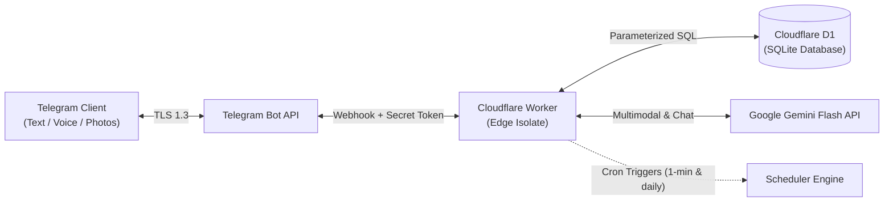

# F.R.I.D.A.Y. — Personal AI Assistant & Productivity Bot

<p align="center">
  
  
  
  
  
  
</p>

**F.R.I.D.A.Y.** is an ultra-fast, intelligent, 100% free personal AI assistant on Telegram. Built on serverless Cloudflare Workers and Cloudflare D1 with Google Gemini Flash intelligence, Friday handles personal cashflow, daily engineering work logs, reminders, and voice interactions with sub-second response times worldwide.

---

## ✨ Key Capabilities

### 🤖 F.R.I.D.A.Y. Tactical Assistant
- **Grounded Real-World AI:** Sharp, direct, and supportive personal chief of staff. Grounded strictly in real-world finance, software engineering, and daily productivity (zero fictional movie tropes).
- **Multi-Turn Conversation Memory:** Remembers conversational context across turns (`chat_history`), enabling natural follow-up queries (*"Can I afford a $45 keyboard?"* ➔ *"What about in Riel?"*).
- **Full Database System Control:** Friday can directly manage your system: add income/expenses, configure monthly budgets, switch currency, and undo transactions.
- **Autonomous Ledger Mistake Correction:** If you say *"40$ was income not expense"* or *"40$ is my income not my expensse"*, Friday automatically deletes the wrongful expense and credits your income ledger.
- **Long-Term Personal Memory Matrix:** Learns and stores your preferences, rules, dietary habits, and goals (`/remember`, `/memory`, `/forget`).
- **Tactical Briefings:** Instant executive status reports (`/briefing`) analyzing cashflow burn, logged work tasks, and upcoming alarms.

### 🎙️ Two-Way Neural Voice Engine
- **Voice-to-Voice Interaction:** Send a voice note, and Friday speaks back to you with natural neural speech (British English & Khmer script auto-detection).
- **Auto-Voice Mode (`/voice on`):** When you are tired of reading text, enable auto-voice to receive spoken audio notes for every response.
- **Smart `/speak` Recall:** Type `/speak` to have Friday read aloud her previous response or any replied-to message.
- **Clean Conversational UX:** Distraction-free chat without repetitive button clutter.

### 💳 Cashflow & Financial Defense
- **Natural Expense & Income Entry:** Type `5 coffee`, `12000 lunch`, `+500 salary`, `40$ income`, or `earned $50 freelance` without formal command syntax.
- **Instant `/undo` Command:** Make a mistake or misclassify an entry? Type `/undo` or just `undo` to immediately purge the last entry from your ledger.
- **Bank Slip & Receipt OCR:** Snap a photo of ABA Bank, Bakong KHQR, Acleda ToanChet, or store receipts — Gemini extracts the exact merchant, currency, amount, and category instantly.
- **Real-Time Affordability Engine:** Ask *"Friday, can I afford a $100 gadget?"* and she calculates exact discretionary funds and runway from your database ledger.
- **Dual-Currency:** Automatic conversion and tracking in USD ($) and Cambodian Riel (KHR ៛) at 1 USD = 4,000 KHR.

### 💼 Engineering Work Journal & Standups
- **Rapid Task Logging:** Type `done Fixed payment webhook race condition` to log accomplishments with timestamps.
- **Scrum Daily Standup (`/standup`):** Generates Yesterday, Today, and Blockers updates with a 1-tap copy block for Slack/Teams.
- **AI Executive Polish (`/standup polish`):** Transforms raw engineering notes into polished, high-impact executive summaries.

### ⏰ Reminders & Cron Automation
- **Natural Timers:** `remind in 25m Review PR` or `remind 17:30 Bring lunch box home`.
- **Automated Morning Briefing:** Daily 08:00 AM ICT tactical briefing pushed automatically via Cloudflare cron triggers.

---

## 🏛️ Architecture



### Free Tier & Performance Metrics
- **Runtime:** Cloudflare Workers (0 MB idle RAM, sub-second execution).
- **Database:** Cloudflare D1 with parallel query batching (`Promise.all`).
- **Monthly Cost:** **$0.00** (operates entirely within free-tier allowances).

---

## 📋 Command Reference

### F.R.I.D.A.Y. Intelligence & Memory
| Command | Shortcut | Description |
| :--- | :--- | :--- |
| `/briefing` | `/friday`, `/status` | Tactical executive status briefing |
| `/remember <fact>` | `/memorize` | Store personal preference, rule, or habit in memory matrix |
| `/memory` | `/memories` | View all long-term memories categorized by `#ID` |
| `/forget <id>` | `/forget all` | Delete a single memory item or wipe memory matrix |
| `/reset` | `/newchat` | Flush active multi-turn conversation context for a clean slate |
| `/voice on` / `off` | `/speak on` | Toggle Auto-Voice mode (always speaks vs. text mode) |
| `/speak` | `/talk`, `/say` | Read aloud Friday's last response, or ask `/speak <question>` |
| `/ask <query>` | `/ai`, chat directly | Natural language financial or productivity questions |

### Cashflow & Ledgers
| Command | Shortcut / Natural Input | Description |
| :--- | :--- | :--- |
| `/today` | `/t`, `today` | View today's itemized transaction ledger |
| `/summary` | `/s` | Monthly spending breakdown, top categories & budget gauge |
| `/month` | `/m` | Monthly financial telemetry |
| `/undo` | `undo`, `/cancel` | Immediately remove and undo the most recent transaction |
| `/add <amt> <cat>` | `5 coffee`, `10000 lunch` | Quick expense recording (zero command friction) |
| `/income <amt>` | `+500 salary`, `40$ income` | Quick income recording |
| `/budget <amt>` | `/b 300 usd` | Set monthly spending threshold with auto-warnings |
| `/export` | `/backup` | Export full transaction ledger as CSV file |

### Work & Productivity
| Command | Shortcut / Natural Input | Description |
| :--- | :--- | :--- |
| `/work` | `/w`, `tasks` | Open Work Journal dashboard |
| `/done <task>` | `did ...`, `finished ...` | Log work accomplishment with timestamp |
| `/standup` | `/su`, `standup` | Generate Scrum standup report with 1-tap copy block |
| `/standup polish` | — | AI-polished standup for Slack / Teams |
| `/report` | `/report last` | Generate monthly accomplishments report |
| `/report polish` | `/polish` | Synthesize monthly report into executive management review |

### System & Navigation
| Command | Shortcut | Description |
| :--- | :--- | :--- |
| `/hub` | `/start`, `/menu` | Open interactive main command center |
| `/settings` | — | Toggle currency (USD/KHR), voice mode, and budgets |
| `/remind <time> <msg>` | `remind in 20m ...` | Set custom reminder |
| `/help` | `/h` | View complete help guide and shortcuts |

---

## 🚀 Deployment & Setup

### Prerequisites
- [Node.js](https://nodejs.org/) (v18+)
- Cloudflare account with [Wrangler CLI](https://developers.cloudflare.com/workers/wrangler/)
- Telegram Bot Token from [@BotFather](https://t.me/BotFather)
- Google Gemini API key from [Google AI Studio](https://aistudio.google.com/)

### 1. Installation
```bash
git clone https://github.com/Sopheaktraleng/assistant-bot.git
cd assistant-bot
npm install
```

### 2. Configure Cloudflare D1
```bash
npx wrangler login
npx wrangler d1 create cashflow_bot
```

Update `wrangler.toml` with your database ID:
```toml
[[d1_databases]]
binding = "DB"
database_name = "cashflow_bot"
database_id = "your-database-id-here"
```

Apply database migrations:
```bash
npm run db:migrate:remote
```

### 3. Set Cloudflare Secrets
```bash
npx wrangler secret put TELEGRAM_BOT_TOKEN
npx wrangler secret put WEBHOOK_SECRET
npx wrangler secret put GEMINI_API_KEY
```

### 4. Deploy & Connect Webhook
```bash
npm run deploy
```

Register your Cloudflare Worker URL with Telegram:
```bash
export TELEGRAM_BOT_TOKEN="your-bot-token"
export WEBHOOK_SECRET="your-webhook-secret"
export WORKER_URL="https://your-worker.your-subdomain.workers.dev"
npm run set:webhook
```

---

## 🧪 Testing

Run the test suite with [Vitest](https://vitest.dev/):
```bash
npm test
```

All 82 unit tests verify:
- Neural speech synthesis and language detection
- Multi-turn conversation history construction
- Long-term memory storage and retrieval
- Deterministic SQLite fallback reasoning
- Bank receipt and invoice OCR parsing

---

## 📄 License

Licensed under the [ISC License](package.json).
