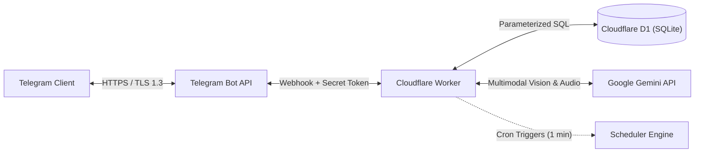

# Personal Assistant Bot

<p align="center">
  
  
  
  
  
</p>

A serverless Telegram assistant for personal finance, work tracking, and automated reminders. Built on Cloudflare Workers and Cloudflare D1 with zero idle resource consumption and sub-second response times worldwide.

---

## Overview

The bot functions as a centralized productivity hub (`/hub`), integrating daily operational workflows into a single conversational interface:

- **Cashflow & Finance:** Dual-currency tracking (USD & KHR) with natural-language expense entry (`5 coffee`, `10000 lunch`), monthly budget gauges, CSV export, and receipt OCR for bank slips (ABA, Bakong KHQR, Acleda) via Gemini.
- **Work Journal & Standups:** Log daily engineering accomplishments (`/done`), generate structured Scrum standups (`/standup`) with one-tap copy, and create executive-ready monthly performance reviews with Gemini AI polish.
- **Reminders & Scheduler:** Automated morning standup and departure reminders, arbitrary relative timers (`remind in 20m`), driven by Cloudflare minute-interval cron triggers.
- **AI Copilot & Voice Notes:** Bilingual conversational Q&A (English and Khmer) over your live database ledger, accompanied by speech-to-action audio processing via Cloudflare Workers AI (Whisper) and Gemini Multimodal.
- **Telegram Web App:** Interactive embedded dashboard (`/dashboard`) featuring Chart.js visual analytics for spending trends, task records, and reminder management.

---

## Architecture



### Security & Design Highlights
- **Zero Idle Overhead:** Runs entirely on Cloudflare edge isolates, spinning down to 0 MB RAM and 0% CPU when not processing requests.
- **Strict Webhook Authentication:** Validates the `X-Telegram-Bot-Api-Secret-Token` header on every request; unauthorized traffic is rejected immediately.
- **SQL Injection Prevention:** All database operations use strictly parameterized prepared statements.
- **Secret Isolation:** Environment secrets (`TELEGRAM_BOT_TOKEN`, `WEBHOOK_SECRET`, `GEMINI_API_KEY`) are managed via Cloudflare encrypted storage.

---

## Command Reference

| Command | Shortcut / Input | Description |
| :--- | :--- | :--- |
| `/hub` | `menu`, `hub` | Open the interactive navigation hub |
| `/dashboard` | — | Launch the Telegram Web Mini-App |
| `/today` | `/t`, `today` | View today's itemized transactions |
| `/summary` | `/s` | View daily spending breakdown and budget status |
| `/month` | `/m` | Current month financial summary |
| `/add <amt> <curr>` | `5 coffee`, `10000 lunch` | Record an expense |
| `/income <amt> <curr>` | `+500 salary` | Record income |
| `/budget <amt> <curr>` | `/b 300 usd` | Set monthly spending threshold |
| `/export` | `/backup` | Export full transaction history as CSV |
| `/done <task>` | `did ...`, `finished ...` | Log a work accomplishment (supports `#tags`) |
| `/standup` | `/su`, `standup` | Generate Scrum standup update with 1-tap copy |
| `/standup polish` | — | Polish standup update for Slack/Teams using Gemini |
| `/report` | `/report last` | Generate monthly accomplishment report |
| `/report polish` | `/polish` | Synthesize monthly report into executive review format |
| `/remind <time> <msg>` | `remind in 15m ...` | Set custom reminder (24h or relative format) |
| `/ask <query>` | `/ai`, casual query | Ask natural questions about spending or work history |
| `/voice` | voice note | Guide and shortcuts for hands-free voice commands |

---

## Getting Started

### Prerequisites
- [Node.js](https://nodejs.org/) (v18 or higher)
- Cloudflare account with [Wrangler CLI](https://developers.cloudflare.com/workers/wrangler/)
- Telegram Bot Token from [@BotFather](https://t.me/BotFather)
- Google Gemini API key from [Google AI Studio](https://aistudio.google.com/)

### 1. Installation
```bash
git clone https://github.com/<your-username>/personal-assistant-bot.git
cd personal-assistant-bot
npm install
```

### 2. Cloudflare D1 Setup
Authenticate with Cloudflare and create the D1 database:
```bash
npx wrangler login
npx wrangler d1 create cashflow_bot
```

Update `wrangler.toml` with the returned `database_id`:
```toml
[[d1_databases]]
binding = "DB"
database_name = "cashflow_bot"
database_id = "your-database-id-here"
```

Apply database migrations:
```bash
npm run db:migrate:remote
```

### 3. Configure Secrets
Set the required secrets in your Cloudflare environment:
```bash
npx wrangler secret put TELEGRAM_BOT_TOKEN
npx wrangler secret put WEBHOOK_SECRET
npx wrangler secret put GEMINI_API_KEY
```

> [!NOTE]
> `WEBHOOK_SECRET` can be any secure random string (e.g., `openssl rand -hex 24`).

### 4. Deploy & Register Webhook
Deploy the worker:
```bash
npm run deploy
```

Register your Cloudflare Worker URL with the Telegram Bot API:
```bash
export TELEGRAM_BOT_TOKEN="your-bot-token"
export WEBHOOK_SECRET="your-webhook-secret"
export WORKER_URL="https://<worker-name>.<subdomain>.workers.dev"
npm run set:webhook
```

---

## Local Development

1. Create a local environment file:
   ```bash
   cp .dev.vars.example .dev.vars
   ```
   Add your `TELEGRAM_BOT_TOKEN`, `WEBHOOK_SECRET`, and `GEMINI_API_KEY`.

2. Initialize the local SQLite database:
   ```bash
   npm run db:migrate:local
   ```

3. Run the development server and test suite:
   ```bash
   npm run dev
   npm test
   ```

---

## Free Tier Utilization

The system is designed to operate 100% within free-tier quotas:

| Provider / Service | Free Tier Allowance | Typical Usage | Est. Cost |
| :--- | :--- | :--- | :--- |
| **Cloudflare Workers** | 100,000 requests / day | 100 – 1,000 req/day | **$0.00** |
| **Cloudflare D1** | 5,000,000 reads + 100,000 writes / day | < 1,000 operations/day | **$0.00** |
| **Google Gemini API** | 15 RPM / 1,500 requests / day | 10 – 50 scans/day | **$0.00** |
| **Telegram Bot API** | Unlimited | Standard messaging | **$0.00** |

---

## License

This project is licensed under the [ISC License](package.json).
